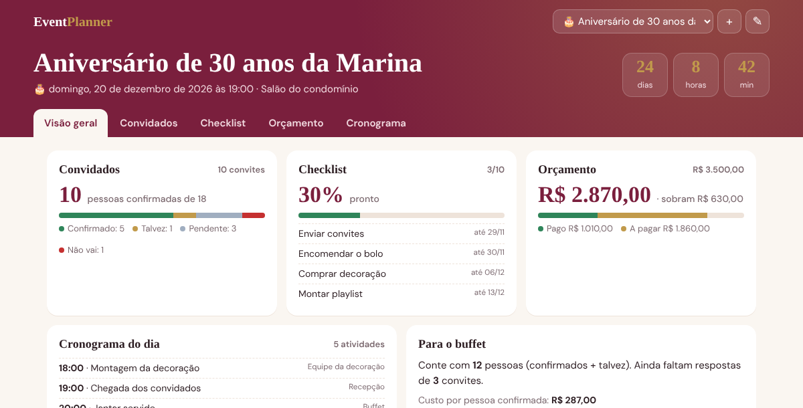

# EventPlanner — Organizador de eventos

Organize eventos com lista de convidados, checklist de tarefas, controle de orçamento e cronograma do dia.

🔗 **[Ver o site no ar](https://iamviniciuslima05.github.io/PROJETO-EventPlanner/)**



## Funcionalidades

- **Vários eventos** com contagem regressiva
- **Convidados** com grupo, acompanhantes e resposta (vai, talvez, não vai)
- **Colar uma lista** de nomes de uma vez e exportar em CSV
- **Checklist** com prazos, responsável e tarefas atrasadas
- Checklist pronta para **aniversário, casamento e evento corporativo**
- **Orçamento** com valor previsto e real, pago e a pagar
- **Cronograma do dia** para copiar e mandar
- Visão geral com tudo resumido

## Tecnologias

HTML5 · CSS3 · JavaScript · localStorage

## Estrutura

```
index.html
css/style.css
js/script.js
```

## Como rodar

Não precisa instalar nada: baixe o projeto e abra o `index.html` no navegador, ou acesse a versão publicada acima.

---
Feito por **Vinicius Lima** · [Portfólio](https://viniciuslimadev.netlify.app) · [LinkedIn](https://www.linkedin.com/in/viniciuslima25/)
